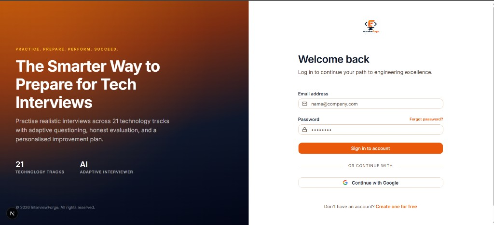
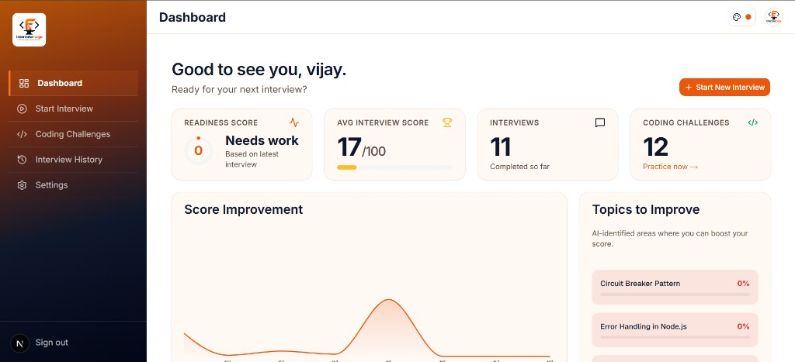
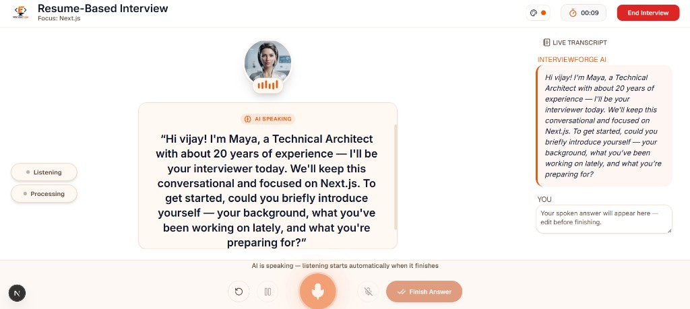
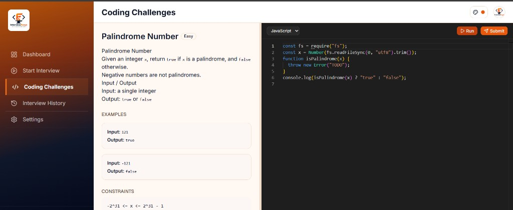

# InterviewForge

AI-powered technical interview and coding assessment platform for candidates and hiring teams.

**Free & open source** under the [MIT License](./LICENSE). Self-host with your own keys — no paid product license required.

**Docs:** [docs/](./docs/README.md) — [Setup](./docs/setup.md) · [Architecture](./docs/architecture.md) · [AI / voice / coding](./docs/ai-voice-coding.md) · [Product flows](./docs/product-flows.md) · [Testing](./docs/testing.md)

**Support development:** [Donate via Razorpay](https://rzp.io/rzp/FnEvT7Ff) — helps cover API/hosting for demos and maintenance. See [Contributing](./CONTRIBUTING.md).

## Screenshots

<p align="center">
  
</p>

<p align="center">
  
</p>

<p align="center">
  
</p>

<p align="center">
  
</p>

## What’s included

- Next.js App Router + TypeScript (strict) + Tailwind CSS + shadcn/ui
- Supabase Auth, Postgres (RLS), Storage (resumes, avatars)
- Candidate onboarding, dashboard, settings, interview wizard
- **Text** and **voice** AI interviews (adaptive questions, evaluation, report)
- Practice coding room + coding / mixed interview rounds (Monaco)
- Swappable providers: AI (`mock` / `openai`), voice STT/TTS, code execution (`mock` / Judge0)
- Admin: technologies, topics, question bank, coding challenges + test cases
- Vitest + Playwright

Default interviewer persona: **Maya** (Technical Architect). First turn uses a deterministic welcome greeting.

Real AI / voice interviews need your own `OPENAI_API_KEY`. Mock providers work offline for local demos and CI.

---

## Prerequisites

- Node.js 22+
- [pnpm](https://pnpm.io/) 10+
- [Docker Desktop](https://www.docker.com/products/docker-desktop/) (Supabase CLI)
- Supabase CLI via the local `supabase` package (`npx supabase`)

---

## Quick start

```bash
cd interviewforge
pnpm install

pnpm db:start
cp .env.example .env.local
pnpm db:status
# Paste NEXT_PUBLIC_SUPABASE_URL, NEXT_PUBLIC_SUPABASE_ANON_KEY,
# and SUPABASE_SERVICE_ROLE_KEY into .env.local

pnpm db:reset
pnpm dev
```

Open [http://localhost:3100](http://localhost:3100).

Default in `.env.example` is `AI_PROVIDER=mock` (no OpenAI key). For real interviews:

```env
AI_PROVIDER=openai
OPENAI_API_KEY=sk-...
OPENAI_MODEL=gpt-4o-mini

VOICE_PROVIDER=openai
VOICE_TTS_VOICE=nova

CODE_EXECUTION_PROVIDER=judge0
JUDGE0_URL=https://ce.judge0.com
```

More detail: [docs/setup.md](./docs/setup.md).

---

## Scripts

| Script | Purpose |
| --- | --- |
| `pnpm dev` | Next.js on port **3100** |
| `pnpm build` / `pnpm start` | Production build / serve |
| `pnpm lint` | ESLint |
| `pnpm db:start` / `db:stop` / `db:status` | Local Supabase |
| `pnpm db:reset` | Migrations + seed |
| `pnpm db:migrate` / `db:seed` / `db:types` | Migrate / seed / regenerate types |
| `pnpm judge0:up` / `judge0:down` / `judge0:logs` | Local Judge0 CE |
| `pnpm test:unit` / `test:integration` / `test:e2e` | Test suites |

---

## Architecture (short)

```
app/                  Marketing, auth, candidate, admin, live interviews, API
components/           Wizard, rooms, voice, coding, admin, settings
lib/ai|voice|…        Swappable providers + interview-engine services
lib/repositories/     Supabase queries only
supabase/             Migrations + seed
docs/                 Full documentation
```

**Rules:** no AI / service-role from the client; repositories vs services split; Zod-validate all AI structured outputs.

See [docs/architecture.md](./docs/architecture.md).

---

## Roles & routes

| Role | Routes |
| --- | --- |
| Public | `/`, `/login`, `/register`, password reset |
| Candidate | `/onboarding`, `/dashboard`, `/settings`, `/interviews/*`, `/practice/*` |
| Admin | `/admin/dashboard`, technologies, topics, questions, challenges |

Promote to admin via `profiles.role_id` → `roles` row `admin`.

---

## License

[MIT](./LICENSE) © 2026 Vijayan PP

Free to use, modify, and distribute. Contributions welcome — see [CONTRIBUTING.md](./CONTRIBUTING.md).

**Support:** [rzp.io/rzp/FnEvT7Ff](https://rzp.io/rzp/FnEvT7Ff)
