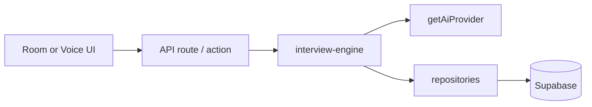

# Architecture

## Stack

- **Next.js** App Router + TypeScript (strict) + Tailwind + shadcn/ui
- **Supabase** Auth, Postgres (RLS), Storage
- **Providers** (swappable): AI (`mock` / `openai`), voice STT/TTS, code execution (`mock` / `judge0`)

## Repository layout

```
app/                  App Router (marketing, auth, candidate, admin, interviews, api)
components/           UI by feature (wizard, interview-room, voice, coding, admin, settings)
lib/
  ai/                 AiProvider, prompts, Zod schemas, opening greeting helper
  voice/              VoiceProvider (STT/TTS)
  code-execution/     CodeExecutionProvider (mock / Judge0)
  services/           Business logic (interview-engine, scoring, coding, question-bank)
  repositories/       Supabase queries only
  actions/            Server actions (profile, onboarding, admin)
  auth/               Auth actions + requireRole
  supabase/           Browser / server / admin / middleware clients
supabase/
  migrations/         Schema, RLS, storage, prompt patches
  seed/               Technologies, topics, prompts, plans, coding challenges
types/                Generated DB types + domain Zod models
tests/                unit / integration / e2e
docs/                 This documentation
```

## Layering rules

1. **Never** call the AI provider or service-role key from client components.
2. **Repositories** own raw Supabase queries; **services** own business logic.
3. Every AI structured response is validated with **Zod** before use.
4. Prefer server actions / route handlers for mutations; keep secrets in `lib/env.ts`.

## Request flow (live interview)



Typical path for answering:

1. Client posts answer (text or voice transcript) to `/api/interviews/[id]/answer`.
2. `interview-engine` evaluates via AI, scores, decides follow-up / next question / end.
3. Persistence through repositories; candidate never sees ideal answers or hidden tests.

## App routes

| Area | Paths |
| --- | --- |
| Public | `/`, `/login`, `/register`, `/forgot-password`, `/reset-password` |
| Onboarding | `/onboarding` |
| Candidate | `/dashboard`, `/settings`, `/interviews/new`, `/interviews/history`, `/practice`, `/practice/[id]` |
| Live session | `/interviews/[id]/room` (text), `/voice`, `/coding`, `/report` |
| Admin | `/admin/dashboard`, `/technologies`, `/topics`, `/questions`, `/challenges` |

`/room` redirects coding sessions to `/coding` and voice delivery to `/voice`.

## Roles

| Role | Access |
| --- | --- |
| `candidate` | Own interviews, practice, settings, dashboard |
| `interviewer` | Recruiter-oriented routes (schema partially present; product UI deferred) |
| `admin` | Content admin (technologies, topics, question bank, challenges) |

RBAC helpers live in `lib/auth/`; middleware/proxy enforces route prefixes.

## Database overview

Migrations under `supabase/migrations/` cover:

- Roles & profiles (+ avatars bucket)
- Technologies / topics
- Resumes & job descriptions
- Interview sessions, questions, answers, evaluations, reports
- Coding challenges, test cases, submissions
- AI prompt versions + audit
- Recruiter orgs & billing **tables** (UI largely deferred)

Seeds (`supabase/seed/`): tech catalog, deep topics for major stacks, sample questions, published prompts, subscription plans, coding challenges.

## Key services

| Service | Responsibility |
| --- | --- |
| `interview-engine` | Start session, generate/evaluate, adapt, report/study plan |
| `scoring` | Adaptive next-action decisions |
| `coding-engine` / `coding-scoring` | Run/submit, weighted coding scores |
| `coding-practice` | AI challenge generation for practice |
| `question-bank` | Admin AI drafts (`skipOpening: true`) |
| `dashboard-service` | Candidate dashboard aggregates |
