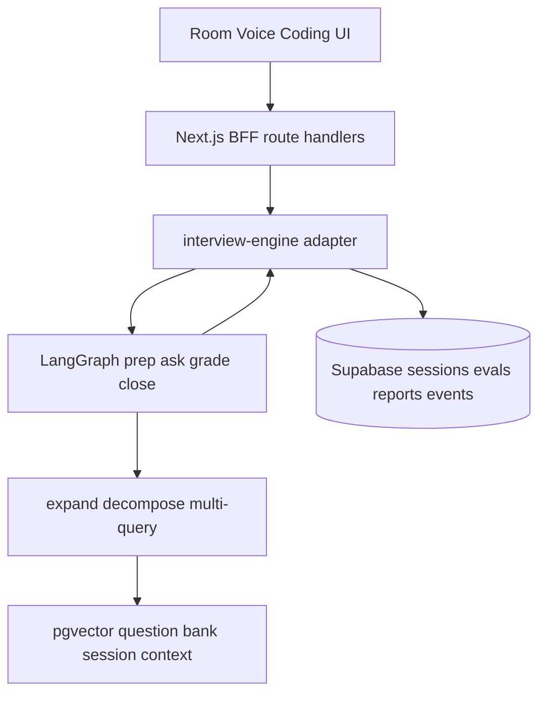
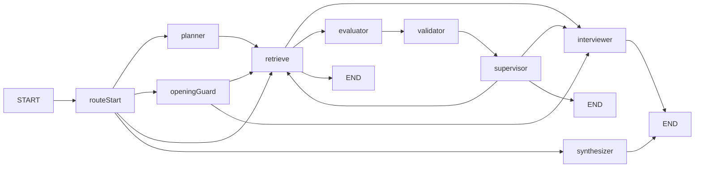

# InterviewForge architecture

This is the current system architecture: a Next.js Backend-for-Frontend over a LangGraph multi-agent interview runtime, with Supabase as the system of record.

Related docs: [Setup](./setup.md) · [Folder structure](./folder-structure.md) · [File catalog](./files/README.md) · [AI, voice & coding](./ai-voice-coding.md) · [Product flows](./product-flows.md) · [Testing](./testing.md)

---

## 1. What the system is

InterviewForge is an AI interview practice platform. A candidate starts a session (text, voice, coding, or mixed). The server:

1. Plans the interview from stack, topics, resume, and job description
2. Retrieves evidence (question bank, resume/JD chunks, topic notes)
3. Asks questions as **Maya** (Technical Architect persona)
4. Grades answers with specialist evaluators
5. Supervises the next action (follow-up, next question, coding handoff, or end)
6. Writes a report and study plan

The browser never calls an LLM, never holds the service-role key, and never imports LangChain.

---

## 2. Stack

| Layer | Choice |
| --- | --- |
| App / BFF | Next.js 16 App Router, React 19, TypeScript strict, Tailwind, shadcn/ui |
| Auth & data | Supabase Auth, Postgres + RLS, Storage (resumes, avatars, proctoring) |
| Interview orchestration | LangChain.js + LangGraph.js (`INTERVIEW_ENGINE=graph`) |
| LLM | LangChain `ChatOpenAI.withStructuredOutput` (mock / openai) |
| Observability | LangSmith traces (optional) + Pino + `interview_events` |
| Embeddings | `text-embedding-3-small` (1536-d) or deterministic mock vectors |
| Retrieval | Query expansion → decomposition → multi-query → pgvector + lexical fallback |
| Voice | Swappable `mock` / OpenAI Whisper + TTS |
| Code runs | Swappable `mock` / Judge0 |

Rollback: set `INTERVIEW_ENGINE=legacy` to use the pre-graph single-provider engine.

---

## 3. High-level design



Three rules hold everywhere:

1. **Client is a view.** Rooms POST answers and render the next question. They do not plan, retrieve, or score.
2. **BFF owns the HTTP contract.** Existing routes (`/api/interviews/[id]/start|answer|end`) stay stable so Playwright and the UI do not change.
3. **Graphs decide; repositories persist.** LangGraph returns structured state. The engine writes questions, evaluations, reports, and events.

---

## 4. Layering

```
app/                  Routes, marketing, auth, candidate, admin, API
components/           Wizard, rooms, voice, coding, admin, settings
lib/
  ai/                 AiProvider, DB prompts, Zod I/O schemas, Maya opening
  agents/             Planner, query agents, specialists, supervisor
  graph/              InterviewState, routing, compiled StateGraph
  retrieval/          Pipeline, embeddings, stores, dedup, rerank
  voice/              STT / TTS providers
  code-execution/     Mock / Judge0
  services/           interview-engine (BFF), scoring, coding, ingest
  repositories/       Supabase SQL only
  actions/            Server actions (profile, onboarding, admin)
  auth/               requireRole, session helpers
  supabase/           Browser / server / admin / middleware clients
supabase/             Migrations + seed
types/                Generated DB types + domain Zod models
```

**Invariants**

| Rule | Why |
| --- | --- |
| Never import `@langchain/*` from client components | Keeps the agent runtime and API keys on the server |
| `server-only` on engine, graph, embeddings, model | Next.js will fail the build if a client file imports them |
| `serverExternalPackages` in [`next.config.ts`](../next.config.ts) | LangChain stays out of the client bundle |
| Repositories = SQL; services = workflow | Testable business logic, no query scatter |
| Every LLM payload is Zod-validated | Invalid model output never reaches the candidate |

---

## 5. Backend for Frontend

Next.js is the BFF (see Next.js “Backend for Frontend” guide). Route handlers authenticate, rate-limit, parse input, and call services. The UI contract is unchanged.

| Method | Path | Graph turn | Persists |
| --- | --- | --- | --- |
| POST | `/api/interviews` | none | Draft session |
| POST | `/api/interviews/[id]/start` | `prep` then `ask` | Plan + first question |
| POST | `/api/interviews/[id]/answer` | `grade` | Answer, evaluation, next question or end |
| POST | `/api/interviews/[id]/end` | `close` | Report + study plan |
| POST | `/api/interviews/[id]/voice/transcribe` | none | Transcript only |
| POST | `/api/interviews/[id]/voice/tts` | none | Audio only |
| POST | `/api/coding/*` | none | Runs / submits (Judge0 or mock) |
| POST | `/api/resumes`, `/api/job-descriptions` | none | File/text + async knowledge ingest |

Adapter: [`lib/services/interview-engine.ts`](../lib/services/interview-engine.ts)

- `INTERVIEW_ENGINE=graph` → [`interview-engine-graph.ts`](../lib/services/interview-engine-graph.ts)
- `INTERVIEW_ENGINE=legacy` → [`interview-engine-legacy.ts`](../lib/services/interview-engine-legacy.ts)

---

## 6. LangGraph interview runtime

One compiled `StateGraph` ([`lib/graph/workflow.ts`](../lib/graph/workflow.ts)), one in-process `MemorySaver` checkpointer, `thread_id = sessionId`.

`turnMode` selects the entry path (same compiled graph, four uses):

| Mode | When | Path |
| --- | --- | --- |
| `prep` | Session start | planner → retrieve → end |
| `ask` | First question | opening_guard → (retrieve) → interviewer → end |
| `grade` | Each answer | retrieve → evaluator → validator → supervisor → interviewer or end |
| `close` | Session end | synthesizer → end |



### State

[`lib/graph/state.ts`](../lib/graph/state.ts) ports Business-Research `ResearchState` and adds interview fields:

- Conversation: `messages`, `sessionId`, `conversationId`
- Plan: `interviewPlan`, `currentTask`, `interviewGoal`
- Retrieval: `expansion`, `decomposition`, `multiQuery`, `retrievedEvidence`, `retrievalTrace`
- Turn: `lastQuestionBody`, `lastCandidateAnswer`, `generatedQuestion`, `lastEvaluation`
- Supervision: `supervisorDecision`, `researchIteration`, `maxResearchIterations`
- Interview: `topicCoverage`, `remainingMinutes`, `questionsAsked`
- Errors: structured `{ stage, error, agent }`

`buildGraphInput()` ([`lib/graph/inputs.ts`](../lib/graph/inputs.ts)) resets per-turn artifacts and keeps plan / messages — same pattern as Business-Research `build_graph_input`.

### Nodes and agents

| Node | Module | Role |
| --- | --- | --- |
| `planner` | [`lib/agents/planner.ts`](../lib/agents/planner.ts) | Coverage plan, phases, specialist tasks |
| `opening_guard` | [`lib/ai/opening-question.ts`](../lib/ai/opening-question.ts) | Deterministic Maya welcome (not LLM) |
| `retrieve` | [`lib/agents/research-engine.ts`](../lib/agents/research-engine.ts) | Full retrieval pipeline |
| `interviewer` | [`lib/agents/interviewer.ts`](../lib/agents/interviewer.ts) | Next or follow-up question |
| `evaluator` | [`lib/agents/evaluators/`](../lib/agents/evaluators/) | Technical, behavioural, or coding grade |
| `validator` | [`lib/agents/evidence-validator.ts`](../lib/agents/evidence-validator.ts) | Claims vs retrieved chunks |
| `supervisor` | [`lib/agents/supervisor.ts`](../lib/agents/supervisor.ts) | `follow_up` / `next_question` / `coding` / `end` / `research_more` |
| `synthesizer` | [`lib/agents/synthesizer.ts`](../lib/agents/synthesizer.ts) | Report + 7/30-day plan |

Behavioural and coding evaluators load published `behavioural_evaluator` and `coding_evaluator` prompts when present; otherwise they fall back to the shared answer evaluator.

### Hard guards

The supervisor LLM never overrides time or question caps. [`decideNextAction`](../lib/services/scoring.ts) still wins, matching Business-Research `max_research_iterations`:

- Remaining time ≤ 0.5 min or questions ≥ 12 → `end`
- Score &lt; 6 and not already a follow-up → `follow_up`
- Mixed type after 2 text questions (and not following up) → `coding`
- Research loop ≥ `maxResearchIterations` (default 2) → force a terminal decision

---

## 7. Retrieval: expansion, decomposition, multi-query

Pipeline: [`lib/retrieval/pipeline.ts`](../lib/retrieval/pipeline.ts)

```text
Interview objective (stack + JD + resume + last answer)
        ↓
   Query expansion          same intent, richer terms
        ↓
   Query decomposition      one vs many atomic questions
        ↓
   ┌────┼────┐
   Q1   Q2   Q3
   ↓    ↓    ↓
   Multi-query              different wording / angles
   ↓    ↓    ↓
   Parallel retrieve
   └────┼────┘
  Dedup → rerank → evidence
```

| Technique | Meaning | Module |
| --- | --- | --- |
| **Expansion** | Same question, extra vocabulary (`slow API` → latency, p99, N+1) | [`query-expander.ts`](../lib/agents/query-expander.ts) |
| **Decomposition** | Split a compound objective into atomic questions | [`query-decomposer.ts`](../lib/agents/query-decomposer.ts) |
| **Multi-query** | Several searches for one sub-question | [`multi-query-generator.ts`](../lib/agents/multi-query-generator.ts) |

**Stores (in order of use)**

| Store | Source | When |
| --- | --- | --- |
| Session context | In-memory chunks of this session’s resume/JD | Always |
| Topic notes | Seeded passages in [`stores/memory.ts`](../lib/retrieval/stores/memory.ts) | Always (and mock/CI) |
| pgvector | `knowledge_chunks` via `match_knowledge_chunks` | `AI_PROVIDER=openai` after migrate |
| Question bank | Approved `interview_questions` where `session_id IS NULL` | `AI_PROVIDER=openai` |
| Web | [`stores/web.ts`](../lib/retrieval/stores/web.ts) | No-op today (reserved for JD/company research) |

Mock runtime skips remote stores so CI never hangs on Supabase. Empty query-agent output falls back to the original objective.

**Ingest** ([`lib/services/knowledge-ingest.ts`](../lib/services/knowledge-ingest.ts)): resume upload, JD create, and question-bank save chunk text, embed, and upsert `knowledge_chunks`. Failures are logged; the user-facing write still succeeds.

---

## 8. Data model (interview + agents)

Core interview tables (migration `0005`+):

```text
profiles
  └── interview_sessions          config.agent.plan / retrieval traces
        ├── interview_questions   live rows (session_id set) or bank (null)
        ├── candidate_answers
        │     └── answer_evaluations
        ├── interview_reports
        └── interview_events      planning | retrieving | evaluating | supervising
```

Knowledge (migration `0019`):

```text
knowledge_chunks
  source_type: resume | job_description | question_bank | topic_knowledge | session_summary
  embedding: vector(1536)
  RLS: owner or admin; public topic notes readable
```

RPC: `match_knowledge_chunks(query_embedding, match_count, filter_candidate, filter_source)`.

The interview plan is also stored on `interview_sessions.config.agent` so a process restart can reuse prep work even though the LangGraph checkpointer is in-memory.

---

## 9. Live session sequences

### Start

1. Wizard creates a `draft` session (`POST /api/interviews`)
2. Room calls `POST /api/interviews/[id]/start`
3. Engine loads resume/JD/profile
4. `prep` graph writes `InterviewPlan` + retrieval trace
5. `ask` graph runs `opening_guard` (Maya welcome) unless `skipOpening`
6. First question is persisted; session becomes `in_progress`

### Answer (text or voice)

1. Voice: TTS → record → STT → optional edit → Finish Answer
2. `POST /api/interviews/[id]/answer` with text (and optional transcript)
3. Engine persists the answer, then `grade` graph:
   retrieve → specialist evaluator → evidence validator → supervisor
4. Supervisor may ask the interviewer for a follow-up or next question
5. Mixed interviews can return `{ action: "coding" }` and the room navigates to `/coding`

### End

1. Time/cap/candidate end → `close` graph + `generateReport`
2. Coding score is merged when a submission exists
3. Report includes overall score, hire-style recommendation, topic breakdown, 7- and 30-day plans

---

## 10. Providers (swappable)

| Concern | Env | Implementations |
| --- | --- | --- |
| Chat / structured agents | `AI_PROVIDER` | `mock` (default, offline) / `openai` (fail-closed if key missing) |
| Embeddings | `OPENAI_EMBEDDING_MODEL` | OpenAI or hash vectors in mock |
| Orchestrator | `INTERVIEW_ENGINE` | `graph` (default) / `legacy` |
| Voice | `VOICE_PROVIDER` | `mock` / `openai` |
| Code | `CODE_EXECUTION_PROVIDER` | `mock` / `judge0` |

Prompts live in `ai_prompt_versions` (draft / published / archived). Loader: [`lib/ai/prompt-loader.ts`](../lib/ai/prompt-loader.ts). See [AI, voice & coding](./ai-voice-coding.md).

---

## 11. Auth, roles, and routes

| Role | Access |
| --- | --- |
| `candidate` | Own interviews, practice, settings, dashboard |
| `interviewer` | Recruiter assessments, invites, proctoring |
| `admin` | Technologies, topics, question bank, challenges |

`proxy.ts` refreshes the Supabase session and applies coarse RBAC. Fine-grained access is RLS on Postgres.

| Area | Paths |
| --- | --- |
| Public | `/`, `/login`, `/register`, password reset |
| Onboarding | `/onboarding` |
| Candidate | `/dashboard`, `/settings`, `/interviews/new`, `/interviews/history`, `/practice` |
| Live | `/interviews/[id]/room`, `/voice`, `/coding`, `/report` |
| Admin | `/admin/dashboard`, `/technologies`, `/topics`, `/questions`, `/challenges` |
| Recruiter | `/recruiter/assessments`, `/invite/[token]` |

---

## 12. Voice, coding, and proctoring

These stay outside the LangGraph turn but share the same BFF and engine:

- **Voice** — STT/TTS only. Graded by the same `submitAnswer` path. Anti-bias prompts forbid scoring accent or demographics.
- **Coding** — Monaco + mock fixtures or Judge0. Hidden tests never leave the server. Mixed interviews hand off after the text round.
- **Proctoring** — recruiter assessments: webcam/screen events, MediaPipe face checks, integrity score. Not part of the agent graph.

---

## 13. Testing and local run

| Suite | What it proves |
| --- | --- |
| Unit | Query agents, retrieval merge, supervisor caps, graph prep → Maya opening |
| Integration | RLS against local Supabase |
| E2E | Playwright room contracts (unchanged) |

```bash
pnpm db:reset          # includes 0019 knowledge + events
pnpm test:unit
pnpm dev               # http://localhost:3100
```

Defaults: `AI_PROVIDER=mock`, `INTERVIEW_ENGINE=graph`. No OpenAI key required for local interviews.

---

## 14. Design rationale

The previous engine was one `AiProvider` plus `if/else` in `decideNextAction`. Resume/JD were truncated into prompts. That is simple, but it cannot retrieve a question bank, split a compound JD, or run specialist graders.

The current design copies Business-Research’s proven shape (planner → specialists → validate → supervise → synthesize) and adds query expansion. Retrieval is corpus-first (resume, JD, bank, topic notes), not web-search-first.

### LangChain and LangSmith

- **LangGraph** compiles the interview `StateGraph` (`prep` / `ask` / `grade` / `close`).
- **LangChain** `ChatOpenAI` runs every specialist structured call (`withStructuredOutput` + Zod).
- **LangSmith** records those graph and LLM runs when tracing is on. Same env names as Business-Research: `LANGSMITH_TRACING`, `LANGSMITH_API_KEY`, `LANGSMITH_PROJECT`, `LANGSMITH_ENDPOINT`.

Mock / CI never send traces. Missing `LANGSMITH_API_KEY` is a warning, not a boot failure.

What we deliberately did **not** change: REST room contracts, Zod I/O schemas, Maya’s deterministic first turn, RLS, mock CI, and the ability to set `INTERVIEW_ENGINE=legacy`.
